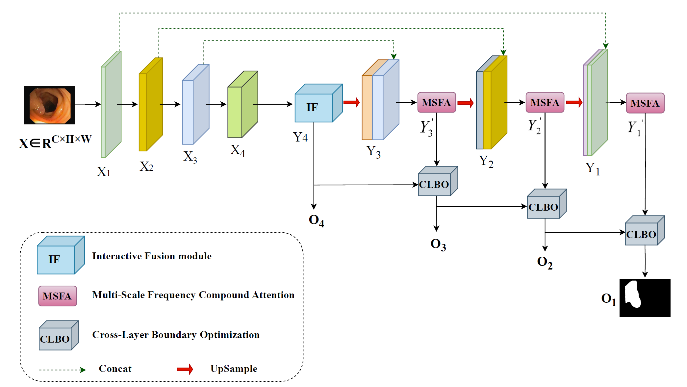

# MSFB-Net: Multi-scale frequency compound attention and cross-layer boundary optimization for medical image segmentation
# Abstract
Medical image segmentation is crucial in disease detection and diagnosis, especially in applications like lesion segmentation and tumor identification. However, existing approaches often struggle to simultaneously capture multi-scale local and global information, reserve high-frequency information, and facilitate the transmission of information flow with high generalization ability. To address these challenges, an advanced medical image segmentation network (MSFB-Net) based on Multi-Scale Frequency Compound Attention and Cross-Layer Boundary Optimization is proposed. Firstly, a Multi-Scale Frequency Compound Attention (MSFCA) is introduced to effectively integrate fine-grained details and global contextual information by fusing multi-level features from spatial and frequency domains. This strategy enhances segmentation precision in handling complex structures while maintaining computational efficiency. Subsequently, a Cross-Layer Boundary Optimization (CLBO) integrating Gaussian convolution and Laplacian pyramid techniques is introduced to concentrate on boundary regions and merges background and boundary features, compensating for high-frequency details loss during extensive upsampling stages. Finally, design an Interactive Fusion module (IF) is designed in the bottleneck layer between the encoder and decoder to extract deeper feature and suppress noise and redundant information by employing residual connection with multi-layer convolution and channel interaction mechanism, thereby facilitating information flow in the network. Extensive experiments are conducted on several publicly available medical imaging datasets, including Kvasir-SEG, CVC-ClinicDB, CVC-ColonDB, ETIS-Larib, CVC-300, the 2018 Data Science Bowl (DSB), ISIC 2018, and Breast Ultrasound Image (BUSI). Comprehensive experimental results demonstrate that the proposed MSFB-Net outperforms state-of-the-art methods. confirming its effectiveness and wide applicability in medical image segmentation.

# Architecture

<p align="center">
  
</p>

# Citations
If you find this work helpful, please cite:
```bibtex
@article{MA2026108405,
title = {MSFB-Net: Multi-scale frequency compound attention and cross-layer boundary optimization for medical image segmentation},
journal = {Biomedical Signal Processing and Control},
volume = {112},
pages = {108405},
year = {2026},
issn = {1746-8094},
doi = {https://doi.org/10.1016/j.bspc.2025.108405},
url = {https://www.sciencedirect.com/science/article/pii/S1746809425009164},
author = {Changlong Ma and Haiyan Li and Xiangxian Li and Shuran Liao and Jundong Yang},
publisher={Elsevier}
```
